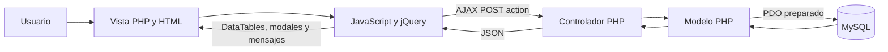
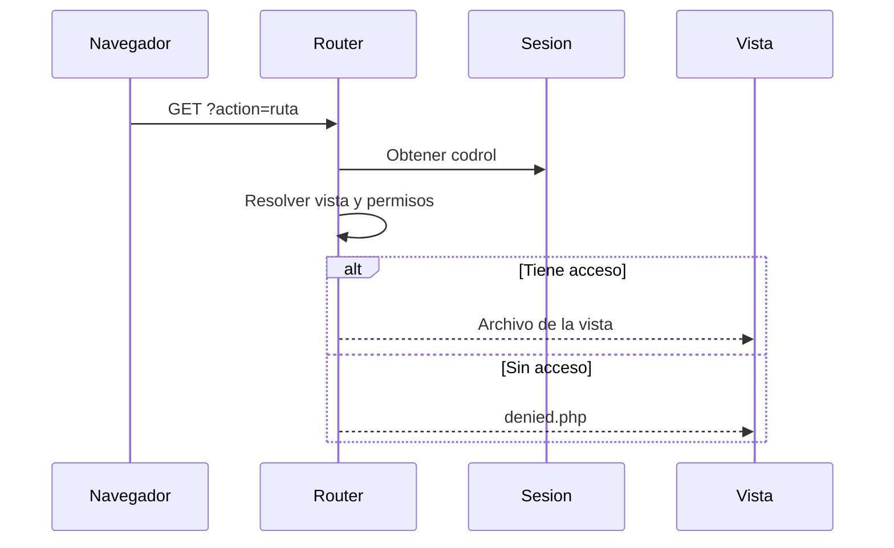
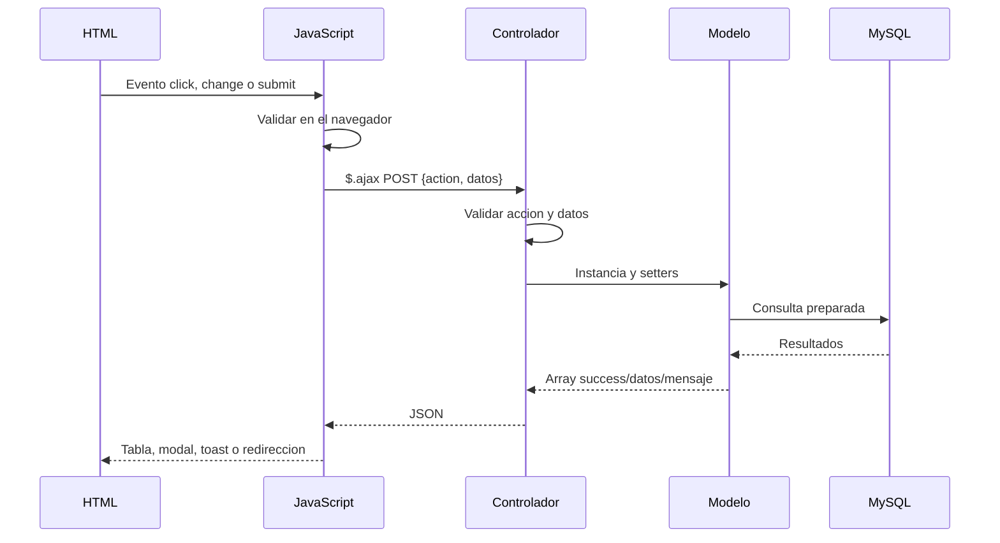
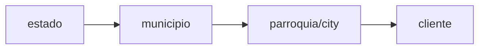
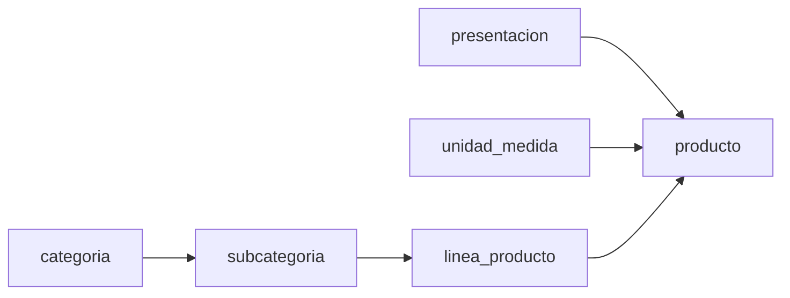
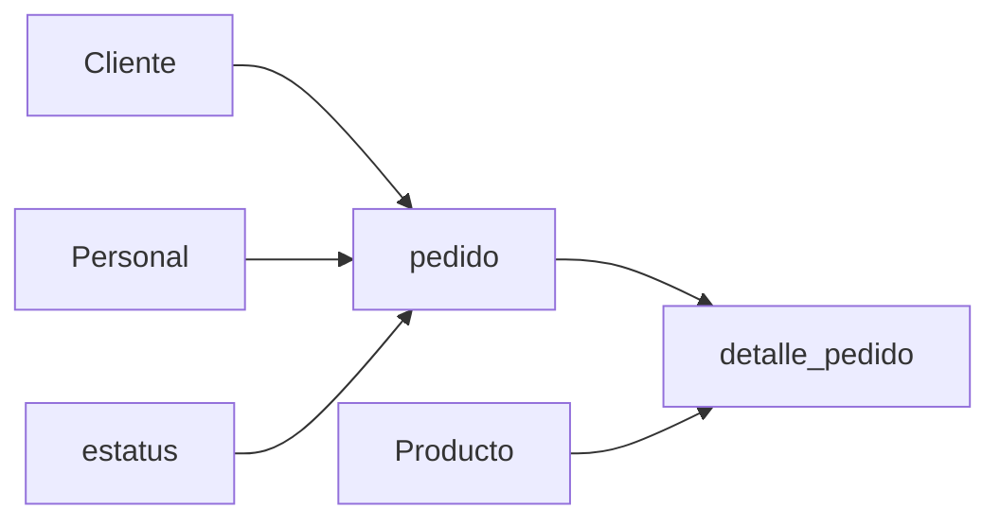
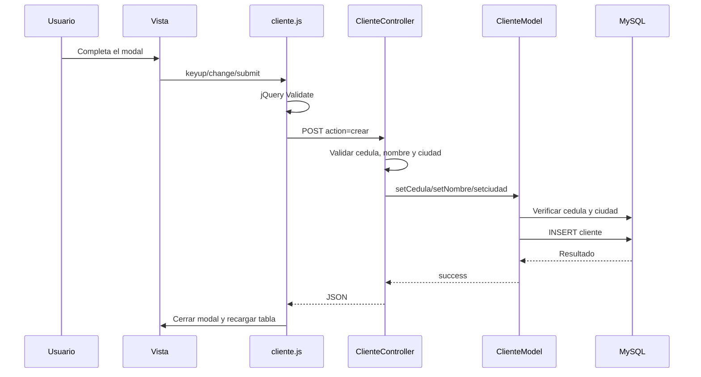

# Flujo de datos completo del sistema

## 1. Proposito

Este documento describe el recorrido de la informacion dentro del sistema desde la interfaz del navegador hasta MySQL y desde la base de datos hasta la interfaz. El sistema utiliza PHP, PDO, JavaScript, jQuery, AJAX, DataTables y sesiones PHP.

## 2. Arquitectura general



### Separacion de responsabilidades

1. Las vistas PHP generan el HTML y cargan los scripts JavaScript.
2. Los scripts JavaScript capturan eventos, validan campos y envian AJAX.
3. Los controladores reciben `$_POST['action']`, validan datos y seleccionan el metodo correspondiente.
4. Los modelos convierten las acciones en consultas preparadas con PDO.
5. MySQL almacena o devuelve la informacion.
6. El controlador devuelve JSON y JavaScript actualiza la tabla o muestra una alerta.

## 3. Entrada al sistema

### 3.1 Carga inicial

1. `index.php` crea `EnlacesController`.
2. `EnlacesController::run()` inicia la sesion.
3. Lee `$_GET['action']`; si no existe, usa `index`.
4. Si el usuario ya tiene sesion activa y abre `index`, se redirige a `home`.
5. Si no tiene sesion e intenta acceder a otra ruta, se redirige a `index`.
6. `app/template/template.php` carga el encabezado, el menu y la vista solicitada.

### 3.2 Resolucion de rutas

`app/core/Router.php` usa el mapa de `config/routes.php`.

Cada ruta indica:

- Vista que debe cargarse.
- Si debe mostrar el menu.
- Roles autorizados.

Los permisos se leen en `config/routes.php` desde las tablas `permisos` y `modulo`. El rol 1 siempre tiene acceso.



### 3.3 Inicio de sesion

1. `login.js` envia `verificarUsuario` y luego `iniciarSesion` al controlador `app/controllers/login.php`.
2. El controlador consulta `usuario` combinado con `personal`.
3. `loginModel::IniciarSesion()` busca el usuario por nombre.
4. PHP verifica que exista, que la contrasena coincida y que el estado sea activo.
5. Si la autenticacion es valida, crea variables en `$_SESSION`:
   - `id`
   - `cedula`
   - `nombre`
   - `apellido`
   - `codrol`
   - `session`
6. El navegador recibe `success: true` y abre `home`.

## 4. Conexion y persistencia

`config/conex.php` contiene la clase `Conexion`.

El sistema abre una conexion PDO con los datos de `config/config.php`. Se utiliza:

- MySQL como motor.
- Consultas preparadas.
- `PDO::ATTR_ERRMODE` en modo excepcion.
- Consultas parametrizadas para evitar recibir valores directamente en SQL.

La conexion principal usa las variables de entorno de base de datos o los valores predeterminados. Tambien existe una configuracion legacy en `config/conex.php` para `conexionVieja()`.

## 5. Flujo AJAX comun

Todos los modulos siguen un patron similar:



Los archivos JavaScript utilizan `action` para indicar la operacion solicitada.

Respuesta habitual:

```json
{
  "success": true,
  "data": [],
  "msj": "Mensaje opcional"
}
```

Respuesta de error habitual:

```json
{
  "success": false,
  "msj": "Descripcion del error"
}
```

## 6. Flujo de clientes

### Archivos principales

- Vista: `app/views/page/clientes/clientes.php`
- Modal: `app/views/page/clientes/modal.php`
- JavaScript: `public/js/cliente.js`
- Controlador: `app/controllers/ClienteController.php`
- Modelo: `app/models/ClienteModel.php`
- Base de datos: tabla `cliente`

### Listar

1. Al abrir el modulo, `cliente.js` crea la tabla con DataTables.
2. Ejecuta la accion `listar`.
3. `ClienteController::listar()` instancia `ClienteModel`.
4. El modelo consulta `cliente` y relaciona:
   - `cliente.id_parroquia` con `parroquia.id`
   - `parroquia.id_municipio` con `municipio.id`
   - `municipio.id_estado` con `estado.id`
5. Devuelve cliente, ciudad, municipio y estado.
6. JavaScript agrega las filas a DataTables.

### Crear

1. El usuario completa cedula, nombre, apellido, sexo, ciudad y direccion.
2. `jQuery Validate` ejecuta las validaciones al escribir.
3. JavaScript elimina o advierte sobre letras en cedula y valida que nombre y apellido sean letras y espacios.
4. Se ejecuta `crear`.
5. El controlador valida formato, longitud, sexo, ciudad y direccion.
6. Verifica que la ciudad exista.
7. Verifica que la cedula no este registrada.
8. `ClienteModel::crear()` ejecuta `INSERT INTO cliente`.

### Consultar y editar

1. JavaScript envia `consultar` con el ID.
2. El modelo busca el cliente completo.
3. Los datos llenan el formulario de edicion.
4. Al guardar se ejecuta `editar`.
5. El controlador vuelve a validar y verifica que la cedula no pertenezca a otro cliente.
6. `ClienteModel::editar()` ejecuta `UPDATE cliente`.

### Eliminar

1. JavaScript solicita confirmacion con SweetAlert.
2. Ejecuta `eliminar` con el ID.
3. El modelo elimina el cliente.
4. JavaScript vuelve a cargar el listado.

### Acciones AJAX

| Accion | Operacion |
|---|---|
| `listar` | Consulta todos los clientes |
| `cargarLineas` | Carga lineas de producto |
| `cargarMedidas` | Carga unidades de medida |
| `listarCiudades` | Carga ciudades disponibles |
| `consultar` | Obtiene un cliente |
| `validarCedula` | Verifica cedula disponible |
| `crear` | Inserta un cliente |
| `editar` | Actualiza un cliente |
| `eliminar` | Elimina un cliente |

## 7. Flujo geografico

### Archivos principales

- Vista: `app/views/page/clientes/ciudades.php`
- JavaScript: `public/js/ubicacion.js`
- Controlador: `app/controllers/UbicacionController.php`
- Modelo: `app/models/UbicacionModel.php`

### Relaciones



### Estados

1. `ubicacion.js` solicita `cargarEstados`.
2. `UbicacionModel::listarEstados()` consulta `estado`.
3. JavaScript llena los selects.

### Municipios

1. Al cambiar el estado se envia `cargarMunicipios`.
2. Se pasa `id_estado`.
3. El modelo consulta `municipio WHERE id_estado = ?`.
4. JavaScript llena el municipio correspondiente.

### Ciudades

1. Al guardar se envia `guardarCiudad`.
2. El controlador valida nombre, estado y municipio.
3. El modelo verifica que el municipio pertenezca al estado.
4. Se inserta en `parroquia`.
5. La tabla y los selects de clientes se actualizan.

La edicion usa `modificarCiudad`. La eliminacion usa `borrarCiudad`, pero el modelo impide eliminar una parroquia asignada a clientes.

## 8. Flujo de productos

### Archivos principales

- Vista: `app/views/page/productos/productos.php`
- Modal: `app/views/page/productos/modal.php`
- JavaScript: `public/js/productos.js`
- Controlador: `app/controllers/ProductoController.php`
- Modelo: `app/models/ProductoModel.php`

### Listar

1. `productos.js` carga lineas, presentaciones y medidas.
2. Ejecuta `listar`.
3. `ProductoModel::listar()` relaciona `producto` con:
   - `linea_producto`
   - `presentacion`
   - `unidad_medida`
4. JavaScript actualiza DataTables.

### Crear

1. Se capturan nombre, linea, presentacion, medida y precio.
2. El navegador valida longitud, campos obligatorios y precio.
3. El controlador valida los datos y que el precio tenga como maximo seis decimales.
4. Verifica que no exista otro producto con el mismo nombre.
5. `ProductoModel::crear()` ejecuta `INSERT INTO producto`.

### Editar

1. `consultar` obtiene el producto y llena el modal.
2. `editar` valida los datos nuevamente.
3. `ProductoModel::editar()` ejecuta `UPDATE producto`.

### Eliminar

1. SweetAlert solicita confirmacion.
2. `eliminar` consulta si el producto esta usado en `detalle_pedido`.
3. Si esta relacionado, no permite eliminarlo.
4. Si no esta relacionado, ejecuta `DELETE FROM producto`.

## 9. Flujo de tablas de configuracion

### Archivos principales

- Vista: `app/views/page/configuracion/configuracion.php`
- Vista compartida: `app/views/page/inventario/presentacion_linea.php`
- Modal compartido: `app/views/page/inventario/modal_presentacion_linea.php`
- JavaScript: `public/js/configuracion.js`
- Validacion comun: `public/js/validaciones.js`
- Controlador: `app/controllers/ConfiguracionController.php`
- Modelo: `app/models/ConfiguracionModel.php`

### Datos administrados

- Categoria
- Subcategoria
- Unidad de medida
- Presentacion
- Linea de producto

### Relaciones



### Operaciones

1. JavaScript carga las cinco tablas.
2. La accion `guardarCategoria`, `guardarSubcategoria`, `guardarMedida`, `guardarPresentacion` o `guardarLinea` determina el tipo.
3. El controlador valida nombre y relaciones.
4. El modelo ejecuta INSERT o UPDATE.
5. Para subcategoria se exige una categoria existente.
6. Para linea de producto se exige una subcategoria existente.
7. `eliminar` valida la tabla permitida y el ID.

Las validaciones se ejecutan en tiempo real al escribir o cambiar el campo. Los errores se muestran con `jQuery Validate` y las acciones exitosas usan toasts o SweetAlert.

## 10. Flujo de personal y usuarios

### Personal

- Vista: `app/views/page/personal/personal.php`
- JavaScript: `public/js/personal.js`
- Controlador: `app/controllers/PersonalController.php`
- Modelo: `app/models/PersonalModel.php`

El personal se registra en `personal`. Puede consultar, crear, editar y eliminar empleados o vendedores. Algunos registros pueden estar asociados a usuarios.

### Usuarios

- Vista: `app/views/page/personal/configuracion_usuarios.php`
- JavaScript: `public/js/configuracion_usuarios.js`
- Modelo: `app/models/PersonalModel.php`

Un usuario se relaciona con personal mediante `usuario.id_personal`. Tambien tiene `username`, `password`, `cod_rol` y `status`.

## 11. Flujo de pedidos

### Archivos principales

- Vista: `app/views/page/pedidos/pedidos.php`
- JavaScript: `public/js/pedidos.js`
- Controlador: `app/controllers/PedidoController.php`
- Modelo: `app/models/PedidoModel.php`

### Crear pedido

1. Se seleccionan cliente y vendedor.
2. Se agrega al detalle uno o varios productos.
3. Se calcula cantidad y precio unitario.
4. JavaScript envia `guardarPedido`.
5. El controlador valida fecha, cliente, vendedor y detalles.
6. El modelo verifica que existan cliente, vendedor y productos.
7. Se inicia una transaccion.
8. Inserta el pedido en `pedido`.
9. Inserta cada linea en `detalle_pedido`.
10. Recalcula el total.
11. Confirma la transaccion.

### Relaciones



### Consultar y editar

- `consultarPedido` devuelve el pedido y su detalle.
- `editarPedido` modifica cliente, vendedor, fecha, productos y cantidades.
- `eliminarPedido` elimina primero el detalle y luego el pedido.
- `cambiarEstatusPedido` modifica el estado.

Las operaciones de pedido deben mantener consistente el total calculado.

## 12. Flujo de ordenes

- Vista: `app/views/page/ordenes/ordenes.php`
- JavaScript: `public/js/ordenes.js`
- Controlador: `app/controllers/OrdenController.php`
- Modelo: `app/models/OrdenModel.php`

Las ordenes reutilizan los datos de `pedido`, `cliente`, `personal`, `estatus` y `detalle_pedido`, con operaciones de consulta, alta, edicion y eliminacion.

## 13. Flujo de permisos y roles

### Archivos

- Vista: `app/views/page/permisos/roles.php`
- JavaScript: `public/js/permisos.js`
- Controlador: `app/controllers/rolController.php`
- Modelo: `app/models/rolModel.php`
- Modelo adicional: `app/models/permisoModel.php`

### Flujo

1. Se consulta la lista de roles.
2. Se consulta la lista de modulos.
3. Se consulta el permiso asignado a cada rol.
4. Al guardar se eliminan los permisos existentes del rol.
5. Se insertan nuevamente los modulos seleccionados.
6. `config/routes.php` vuelve a leer `permisos` y controla el acceso visible.

El rol 1 siempre conserva acceso administrativo aunque no este definido en la tabla de permisos.

## 14. Flujo de reportes

### Archivos

- Vista: `app/views/page/reportes/reportes.php`
- JavaScript: `public/js/reportes.js`
- Controlador: `app/controllers/ReportesAjaxController.php`
- Modelo: `app/models/ReportesModel.php`

Los reportes consultan datos combinados de cliente, vendedor, producto, pedido y detalle. El resultado se muestra en tablas o en PDF con FPDF.

El reporte no modifica registros principales. Sus consultas deben leer datos actuales y agregados.

## 15. Tablas y relaciones principales

| Tabla | Funcion |
|---|---|
| `usuario` | Credenciales, rol y estado del usuario |
| `personal` | Personas asociadas al sistema |
| `tipo_personal` | Tipo de personal |
| `roles` | Roles disponibles |
| `modulo` | Modulos del sistema |
| `permisos` | Relacion entre rol y modulo |
| `cliente` | Datos del cliente |
| `estado` | Estados geograficos |
| `municipio` | Municipios asociados a estados |
| `parroquia` | Ciudades o parroquias |
| `categoria` | Categorias de producto |
| `subcategoria` | Subcategorias asociadas |
| `linea_producto` | Lineas asociadas a subcategorias |
| `presentacion` | Presentacion o contenido |
| `unidad_medida` | Unidad de medida |
| `producto` | Datos del producto |
| `pedido` | Encabezado de la venta |
| `detalle_pedido` | Productos de cada pedido |
| `estatus` | Estado del pedido |

## 16. Flujo de validacion

El sistema aplica validacion en dos niveles:

### Nivel navegador

- `jQuery Validate`.
- Eventos `keyup` y `change`.
- Validacion de requerido, longitud, numero, nombre y relaciones.
- `ValidacionTiempoReal.activar()` centraliza la activacion de validaciones.
- `validaciones.js` contiene metodos comunes.

### Nivel servidor

- El controlador vuelve a validar los datos.
- Se usan expresiones regulares y limites.
- Se verifican IDs positivos y registros existentes.
- Los modelos reciben datos preparados.
- Las consultas SQL utilizan parametros.

Esto evita que una respuesta del navegador sea suficiente por si sola para guardar datos invalidos.

## 17. Manejo de respuestas

### Exito

- El controlador establece HTTP 200 y devuelve `success: true`.
- JavaScript actualiza DataTables.
- Cierra modales.
- Muestra toast o SweetAlert.
- Recarga catalogos relacionados cuando corresponde.

### Error de validacion

- El controlador devuelve HTTP 400.
- El campo invalido se muestra al usuario.
- JavaScript conserva abierto el formulario.

### Error de servidor

- El controlador devuelve HTTP 500.
- JavaScript muestra el mensaje recibido o un mensaje general.
- No se produce una falsa confirmacion de guardado.

### No encontrado

- El controlador devuelve HTTP 404.
- Se informa que el registro no existe.

### Conflicto

- Se devuelve HTTP 409 o 400 cuando existe una relacion o duplicado.
- Ejemplos: nombre repetido, cedula repetida o producto asociado a pedidos.

## 18. Ciclo completo de una operacion CRUD

Ejemplo para crear un cliente:



## 19. Archivos centrales

| Archivo | Responsabilidad |
|---|---|
| `index.php` | Punto de entrada |
| `app/controllers/enlacesController.php` | Sesion, rutas y carga de vistas |
| `app/core/Router.php` | Resolucion y autorizacion |
| `config/routes.php` | Mapa de rutas y permisos |
| `app/template/template.php` | Plantilla HTML |
| `config/conex.php` | Conexion PDO |
| `config/config.php` | Configuracion de base de datos |
| `app/core/BaseController.php` | Respuestas JSON y sesiones |
| `public/js/validaciones.js` | Validaciones comunes en tiempo real |

## 20. Resumen del recorrido

Un usuario inicia sesion, PHP guarda su rol en sesion y el router decide a que vistas puede acceder. Cada vista carga un JavaScript asociado. Ese JavaScript valida al escribir y envia operaciones mediante AJAX con una accion y sus datos. El controlador verifica nuevamente la informacion, instancia el modelo correspondiente y usa consultas preparadas contra MySQL. El resultado vuelve como JSON y JavaScript lo muestra en tablas, modales o mensajes sin recargar toda la pagina.
